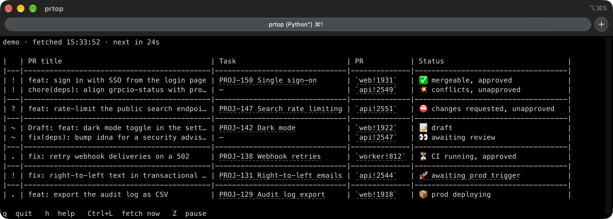

# prtop

[](https://github.com/TomyCesaille/prtop/actions/workflows/ci.yml)

The merge requests assigned to you, from review to production, in one terminal
table that refreshes in place, the way `htop` shows processes.



prtop reads GitLab through the [`glab`](https://gitlab.com/gitlab-org/cli) CLI
and never writes to it: it does not merge, rebase, or trigger a job. Each merge
request assigned to you gets one row, marked with whose move it is. Once one
merges, prtop follows its pipeline to production and drops the row when
production runs it.

## Install

prtop reads GitLab as you, through `glab`, so sign `glab` in to your instance
first:

```bash
glab auth login --hostname gitlab.example.com
```

| Where | How |
|---|---|
| macOS, Linux | `brew install TomyCesaille/tap/prtop` |
| Windows | `choco install prtop` |
| Anywhere with Python 3.14 or later | `uv tool install git+https://github.com/TomyCesaille/prtop` |

Homebrew and Chocolatey install `glab` alongside prtop. On Windows, run prtop in
Windows Terminal, the default terminal on Windows 11: the older console shows the
emoji as boxes and cannot open links.

Then point prtop at your instance, in `~/.config/prtop/.env`
(`%APPDATA%\prtop\.env` on Windows):

```bash
PRTOP_GITLAB_HOST=gitlab.example.com
```

## Use

```bash
prtop
```

In a terminal, prtop takes the screen and fetches again every 30 seconds. The top
line names the instance, the time of the last fetch and the countdown to the
next one; the bottom line lists the keys.

| Key | Does |
|---|---|
| `q`, F10, Ctrl+C | quit |
| `h`, `?`, F1 | show or hide the help: the keys and what the marks mean |
| Ctrl+L | fetch now |
| `Z` | pause or resume fetching |

| Option | Does |
|---|---|
| `-d SECONDS` | seconds between fetches (default 30) |
| `-n N` | stop after N fetches and leave the last table in the terminal; `prtop -n 1` prints one table |
| `--demo` | show made-up merge requests, without reading GitLab |

When its output is not a terminal (a pipe, a file, a script, an AI agent), prtop
prints the table once and exits. Errors go to stderr, so the output stays one
table.

## Reading the table

```text
|   | PR title                                   | Task                          | PR           | Status                             |
|---|--------------------------------------------|-------------------------------|--------------|------------------------------------|
| ! | feat: sign in with SSO from the login page | PROJ-150 Single sign-on       | `web!1931`   | ✅ mergeable, approved             |
| ! | chore(deps): align grpcio-status with pro… | —                             | `api!2549`   | 💥 conflicts, unapproved           |
|---|--------------------------------------------|-------------------------------|--------------|------------------------------------|
| ? | feat: rate-limit the public search endpoi… | PROJ-147 Search rate limiting | `api!2551`   | ⛔ changes requested, unapproved   |
|---|--------------------------------------------|-------------------------------|--------------|------------------------------------|
| ~ | Draft: feat: dark mode toggle in the sett… | PROJ-142 Dark mode            | `web!1922`   | 📝 draft                           |
| ~ | fix(deps): bump idna for a security advis… | —                             | `api!2547`   | 👀 awaiting review                 |
|---|--------------------------------------------|-------------------------------|--------------|------------------------------------|
| . | fix: retry webhook deliveries on a 502     | PROJ-138 Webhook retries      | `worker!812` | ⏳ CI running, approved            |
|---|--------------------------------------------|-------------------------------|--------------|------------------------------------|
| ! | fix: right-to-left text in transactional … | PROJ-131 Right-to-left emails | `api!2544`   | 🚀 awaiting prod trigger           |
|---|--------------------------------------------|-------------------------------|--------------|------------------------------------|
| . | feat: export the audit log as CSV          | PROJ-129 Audit log export     | `web!1918`   | 📦 prod deploying                  |
```

The first column says whose move it is:

| Mark | Means | For instance |
|---|---|---|
| `!` | on you now | approved and mergeable, rebase needed, conflicts, your own threads left to resolve, a failed pipeline, a production job awaiting its trigger |
| `?` | on you to look at or reply to | changes requested, a reviewer's unresolved threads, a status prtop does not know |
| `~` | on someone else, until a person moves | awaiting review, draft, blocked by another merge request |
| `.` | on a machine; it resolves by itself | CI running, merge check running, production deploying |

Open merge requests come first, merged ones on their way to production below
them. Within each group, rows sort by mark, then by task, repository and number,
and a rule separates one mark from the next.

A state is never told by colour or emoji alone. The mark, the row's position and
the words in the Status column each carry it; the emoji repeats it. The marks
also read as a weight gradient, `!` the heaviest shape and `.` the lightest, so
the eye lands on the top of the table first.

In terminals that support hyperlinks, the PR cell opens the merge request, the
Task cell opens the task, and `awaiting prod trigger` opens the page the
production job is triggered from.

In the live view, a row whose state changed shows in reverse video until the next
fetch that changes something, and the top line gives the time of that change.

When GitLab does not answer, one `! 🔌 instance unreachable` row stands in for the
open merge requests rather than showing states the fetch could not confirm.

## Following merges to production

When a merge request leaves the open list merged, prtop finds the pipeline of its
merge commit on the target branch and follows it:

| Status | Mark |
|---|---|
| `⏳ pipeline running` (or pending, created…) | `.` |
| `❌ pipeline failed` | `!` |
| `🚀 awaiting prod trigger` | `!` |
| `📦 prod deploying` | `.` |
| `❌ prod deploy failed` | `!` |
| `➖ prod <job status>` | `?` |
| `🔌 check failed: <error>` | `?` |

The row leaves the table once production runs its commit: when its own production
job succeeded, or when a later pipeline on the same branch did, since a later
deploy carries the earlier commits with it. A pipeline that finishes without any
production job leaves the table too, having nothing to deploy.

prtop tells production deploy jobs apart by name, with two settings:

- `PRTOP_DEPLOY_JOB_PATTERN`, default `deploy.*prod|prod.*deploy`, matches every job
  that deploys to production, and leaves out jobs such as `migrate_production` or
  `test_production`.
- `PRTOP_PRIMARY_DEPLOY_JOB_PATTERN`, default `^deploy[_-]production$`, picks among
  those the job whose success means the app itself shipped, as opposed to side
  services deployed beside it. When no job matches it, every production deploy
  job counts.

Both are regular expressions, matched without regard to case.
`PRTOP_DEPLOY_TRACKING=off` turns the following off altogether.

## Configuration

Settings are `PRTOP_*` variables, read from the environment first and from the env
file second. The env file holds `KEY=VALUE` lines; `#` starts a comment, and an
empty value counts as unset. [`.env.example`](.env.example) lists every setting.

| | macOS and Linux | Windows |
|---|---|---|
| Env file | `~/.config/prtop/.env` | `%APPDATA%\prtop\.env` |
| State | `~/.local/state/prtop/<host>.json` | `%LOCALAPPDATA%\prtop\<host>.json` |

`XDG_CONFIG_HOME` and `XDG_STATE_HOME` replace the base directory on every
platform, and `PRTOP_CONFIG_FILE` / `PRTOP_STATE_FILE` name the files outright.

| Setting | Default | |
|---|---|---|
| `PRTOP_GITLAB_HOST` | `gitlab.com` | The instance to read. |
| `PRTOP_GITLAB_GROUP` | the whole instance | Only list merge requests in this group and its subgroups. |
| `PRTOP_GITLAB_USERNAME` | read from the instance | Your username, to tell your own threads from a reviewer's. |
| `PRTOP_TASK_SOURCE` | `none` | Where the Task column comes from: `none`, `issues`, `notion`, `jira` or `branch`. |
| `PRTOP_TASK_BRANCH_PATTERN` | | The branch convention for `PRTOP_TASK_SOURCE=branch`. |
| `PRTOP_TASK_URL` | | The task link, built from the pattern's groups. |
| `PRTOP_DEPLOY_TRACKING` | `on` | Follow merged merge requests to production. |
| `PRTOP_DEPLOY_JOB_PATTERN` | `deploy.*prod\|prod.*deploy` | Jobs that deploy to production. |
| `PRTOP_PRIMARY_DEPLOY_JOB_PATTERN` | `^deploy[_-]production$` | The one among them that ships the app. |
| `PRTOP_ITERM_TAB_COLOR` | `off` | In iTerm2, the live view colours the tab orange while an open merge request is on you, green otherwise. |
| `PRTOP_CONFIG_FILE` | see above | The env file. |
| `PRTOP_STATE_FILE` | see above | The state file. |

A setting prtop does not know is reported on stderr and ignored, so a typo shows
up rather than silently keeping a default.

### The Task column

With `PRTOP_TASK_SOURCE=none` the column is left out and the titles take its width.

- `issues`: the issues the merge request closes (`Closes #123` in its description).
- `notion`: a branch named after a Notion page,
  `<prefix>/<ticket>-<title>-<32-hex page id>`, linked to the page.
- `jira`: a branch carrying a Jira key, `<prefix>/PROJ-123-<title>`. Set
  `PRTOP_TASK_URL=https://jira.example.com/browse/{id}` to link it.
- `branch`: any branch convention, as a regular expression searched in the branch
  name. A `task` group is the label; without one, the label is the `id` group
  followed by the `title` group. Every group is available to `PRTOP_TASK_URL`:

  ```bash
  PRTOP_TASK_SOURCE=branch
  PRTOP_TASK_BRANCH_PATTERN=(?P<id>\d+)-(?P<title>[^/]+)$
  PRTOP_TASK_URL=https://tracker.example.com/tasks/{id}
  ```

### The state file

The state file records the open merge requests of the last fetch, which is how the
next fetch tells that one merged, and the merged ones still on their way to
production. It is safe to delete: the next fetch starts a fresh baseline, and a
merge request that merged in between is not followed to production.

## With an AI agent

An agent reads the one-table output: `prtop` run by an agent prints the table and
exits, and the mark column is the state to act on. prtop never writes to GitLab,
so merging, rebasing or triggering a deploy stays with the agent, behind your
confirmation.

`prtop watch` waits for something to happen, for an agent to run in the
background and be woken by:

- it checks every 5 minutes (`-d SECONDS`) and prints a `[watch] <time> no change`
  line after each quiet check;
- it exits 0 with the new table as soon as the table changes;
- it exits 0 with a `TIMEOUT after <cap>s with no PR activity` line after
  `--cap SECONDS` of quiet (2 hours by default);
- it exits 1 with a `[watch] check failed` line when a check fails.

[`examples/claude-code`](examples/claude-code) sets this up for Claude Code: a
`/prs` command and the instructions for watching a merge request in the
background.

## Contributing

See [CONTRIBUTING.md](CONTRIBUTING.md), and [AGENTS.md](AGENTS.md) for the rules
the code holds to.

## License

[MIT](LICENSE)
