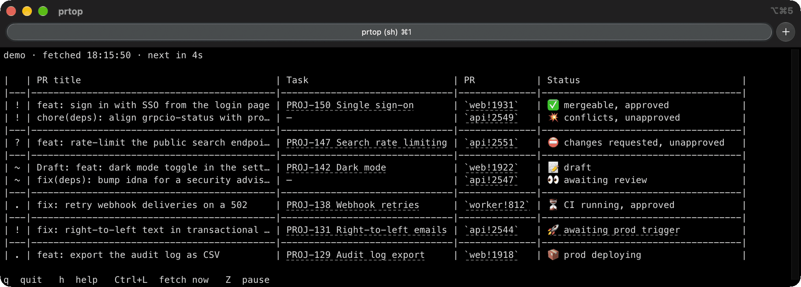

# prtop

htop for your merge requests. Your GitLab MRs, from review to production, live
in your terminal. Built to wake Claude Code.

[](#install)
[](https://github.com/TomyCesaille/prtop/blob/main/LICENSE)
[](https://github.com/TomyCesaille/prtop/actions/workflows/ci.yml)



[Website](https://tomycesaille.github.io/prtop/) | [Claude Code setup](examples/claude-code)

## Install

prtop reads GitLab as you, through `glab`, so sign `glab` in to your instance
first:

```bash
glab auth login --hostname gitlab.example.com
```

| Where | How |
|---|---|
| macOS, Linux | `brew install TomyCesaille/tap/prtop` |
| Windows | `choco install prtop` |
| Anywhere with Python 3.14 or later | `uv tool install git+https://github.com/TomyCesaille/prtop` |

Homebrew and Chocolatey install `glab` alongside prtop. On Windows, run prtop in
Windows Terminal, the default terminal on Windows 11: the older console shows the
emoji as boxes and cannot open links.

Then point prtop at your instance, in `~/.config/prtop/.env`
(`%APPDATA%\prtop\.env` on Windows):

```bash
PRTOP_GITLAB_HOST=gitlab.example.com
```

## Set up with Claude Code

Paste this into Claude Code:

```text
Set up prtop for me: follow https://raw.githubusercontent.com/TomyCesaille/prtop/main/examples/claude-code/SETUP.md
```

It installs prtop, checks your GitLab sign-in, fits the settings to your
projects, and adds a `/prs` command, asking you at each step.

## Use

```bash
prtop
```

In a terminal, prtop takes the screen and fetches again every 30 seconds. The top
line names the instance, the time of the last fetch and the countdown to the
next one; the bottom line lists the keys.

| Key | Does |
|---|---|
| `q`, F10, Ctrl+C | quit |
| `h`, `?`, F1 | show or hide the help: the keys and what the marks mean |
| Ctrl+L | fetch now |
| `Z` | pause or resume fetching |

| Option | Does |
|---|---|
| `-d SECONDS` | seconds between fetches (default 30) |
| `-n N` | stop after N fetches and leave the last table in the terminal; `prtop -n 1` prints one table |
| `--demo` | show made-up merge requests, without reading GitLab |

When its output is not a terminal (a pipe, a file, a script, an AI agent), prtop
prints the table once and exits. Errors go to stderr, so the output stays one
table.

## Reading the table


## Configuration

Settings are `PRTOP_*` variables, read from the environment first and from the env
file second. The env file holds `KEY=VALUE` lines; `#` starts a comment, and an
empty value counts as unset. [`.env.example`](.env.example) lists every setting.

| | macOS and Linux | Windows |
|---|---|---|
| Env file | `~/.config/prtop/.env` | `%APPDATA%\prtop\.env` |
| State | `~/.local/state/prtop/<host>.json` | `%LOCALAPPDATA%\prtop\<host>.json` |

`XDG_CONFIG_HOME` and `XDG_STATE_HOME` replace the base directory on every
platform, and `PRTOP_CONFIG_FILE` / `PRTOP_STATE_FILE` name the files outright.

| Setting | Default | |
|---|---|---|
| `PRTOP_GITLAB_HOST` | `gitlab.com` | The instance to read. |
| `PRTOP_GITLAB_GROUP` | the whole instance | Only list merge requests in this group and its subgroups. |
| `PRTOP_GITLAB_USERNAME` | read from the instance | Your username, to tell your own threads from a reviewer's. |
| `PRTOP_TASK_SOURCE` | `none` | Where the Task column comes from: `none`, `issues`, `notion`, `jira` or `branch`. |
| `PRTOP_TASK_BRANCH_PATTERN` | | The branch convention for `PRTOP_TASK_SOURCE=branch`. |
| `PRTOP_TASK_URL` | | The task link, built from the pattern's groups. |
| `PRTOP_DEPLOY_TRACKING` | `on` | Follow merged merge requests to production. |
| `PRTOP_DEPLOY_JOB_PATTERN` | `deploy.*prod\|prod.*deploy` | Jobs that deploy to production. |
| `PRTOP_PRIMARY_DEPLOY_JOB_PATTERN` | `^deploy[_-]production$` | The one among them that ships the app. |
| `PRTOP_ITERM_TAB_COLOR` | `off` | In iTerm2, the live view colours the tab orange while an open merge request is on you, green otherwise. |
| `PRTOP_CONFIG_FILE` | see above | The env file. |
| `PRTOP_STATE_FILE` | see above | The state file. |

A setting prtop does not know is reported on stderr and ignored, so a typo shows
up rather than silently keeping a default.

### The Task column

With `PRTOP_TASK_SOURCE=none` the column is left out and the titles take its width.

- `issues`: the issues the merge request closes (`Closes #123` in its description).
- `notion`: a branch named after a Notion page,
  `<prefix>/<ticket>-<title>-<32-hex page id>`, linked to the page.
- `jira`: a branch carrying a Jira key, `<prefix>/PROJ-123-<title>`. Set
  `PRTOP_TASK_URL=https://jira.example.com/browse/{id}` to link it.
- `branch`: any branch convention, as a regular expression searched in the branch
  name. A `task` group is the label; without one, the label is the `id` group
  followed by the `title` group. Every group is available to `PRTOP_TASK_URL`:

  ```bash
  PRTOP_TASK_SOURCE=branch
  PRTOP_TASK_BRANCH_PATTERN=(?P<id>\d+)-(?P<title>[^/]+)$
  PRTOP_TASK_URL=https://tracker.example.com/tasks/{id}
  ```

## With an AI agent

An agent reads the one-table output: `prtop` run by an agent prints the table and
exits, and the mark column is the state to act on. prtop never writes to GitLab,
so merging, rebasing or triggering a deploy stays with the agent, behind your
confirmation.

`prtop watch` waits for something to happen, for an agent to run in the
background and be woken by:

- it checks every 5 minutes (`-d SECONDS`) and prints a `[watch] <time> no change`
  line after each quiet check;
- it exits 0 with the new table as soon as the table changes;
- it exits 0 with a `TIMEOUT after <cap>s with no PR activity` line after
  `--cap SECONDS` of quiet (2 hours by default);
- it exits 1 with a `[watch] check failed` line when a check fails.

[`examples/claude-code`](examples/claude-code) sets this up for Claude Code: a
`/prs` command and the instructions for watching a merge request in the
background.

## Contributing

See [CONTRIBUTING.md](CONTRIBUTING.md), and [AGENTS.md](AGENTS.md) for the rules
the code holds to.

## License

[MIT](LICENSE)
